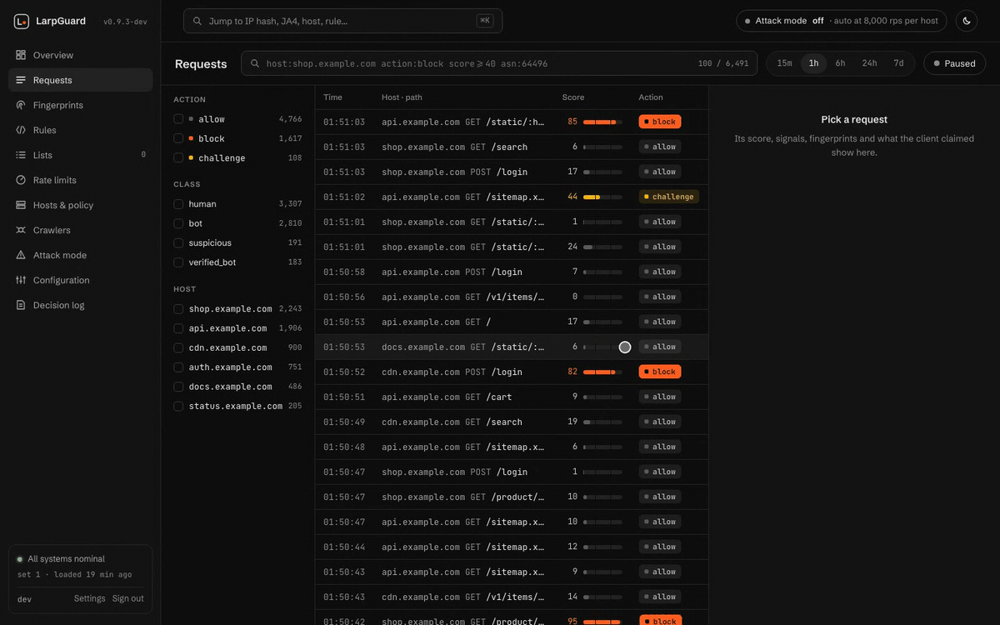
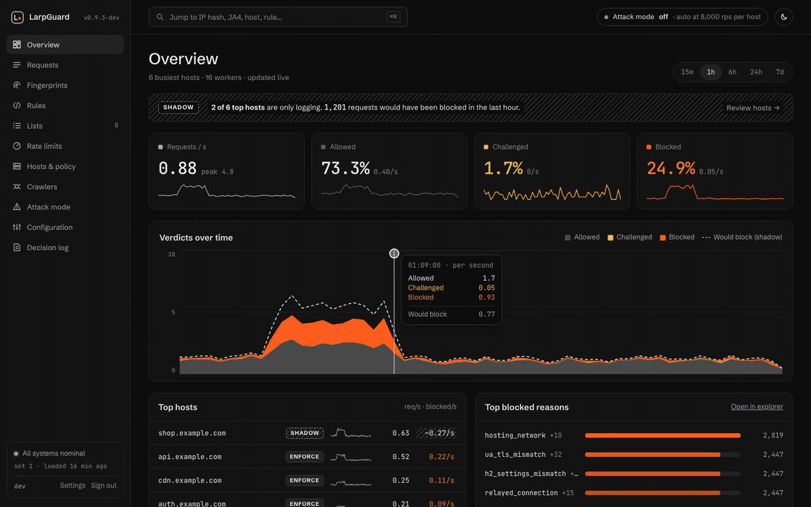
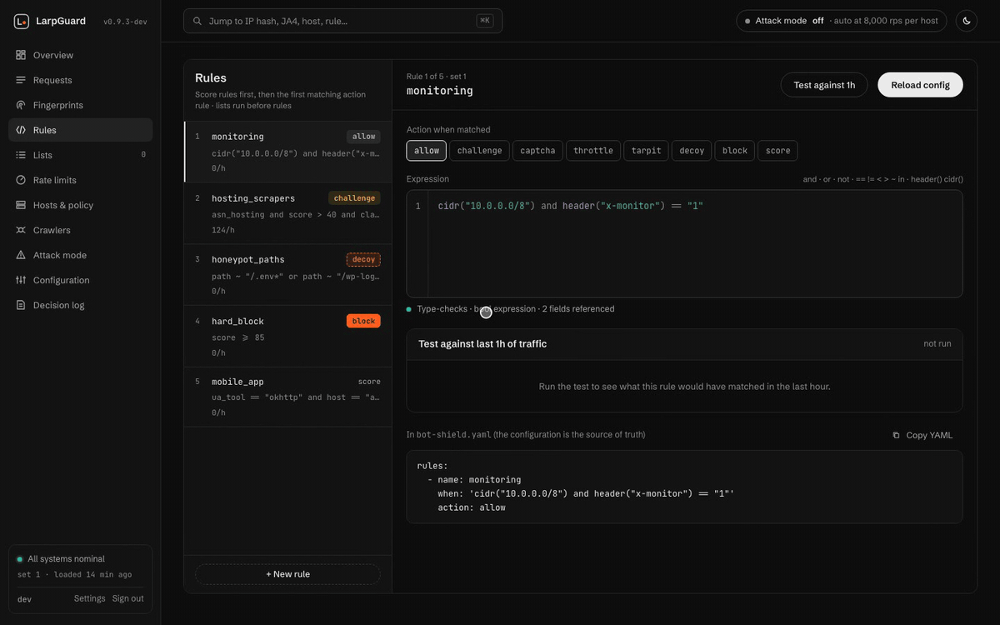
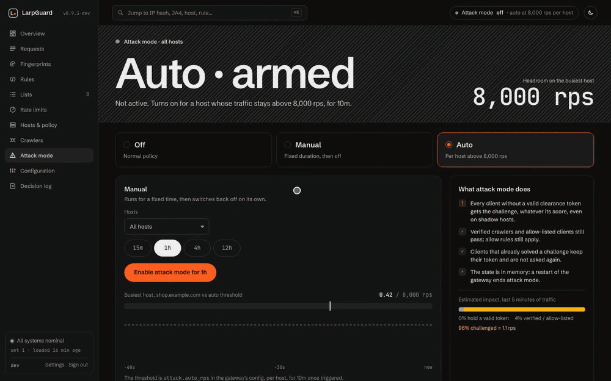
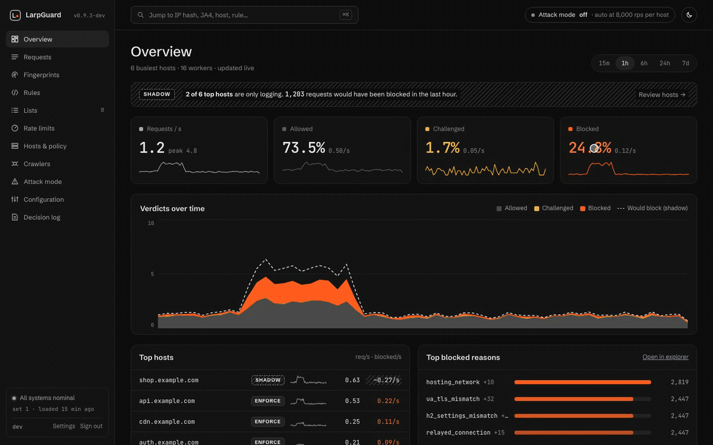

<div align="center">

# 🛡️ LarpGuard

**A self-hosted bot-filtering gateway that sits in front of Traefik.**

It looks at how a client really talks (TCP, TLS, HTTP/2, HTTP/3, JS) and
checks that against what the client says it is.

<p>
  <a href="LICENSE"></a>
  
  
  
</p>
<p>
  
  
  
  
  
  
</p>
<p>
  <a href="https://github.com/kewldan/LarpGuard/actions/workflows/ci.yml"></a>
  <a href="https://github.com/kewldan/LarpGuard/pkgs/container/larpguard"></a>
  <a href="https://github.com/kewldan/LarpGuard/stargazers"></a>
  <a href="https://github.com/kewldan/LarpGuard/commits/main"></a>
  
  
</p>

</div>

---

A scraper can copy Chrome's `User-Agent` string in one line of code.
Copying Chrome's TLS ClientHello, HTTP/2 settings frame, header order and
TCP SYN all at once is much harder. LarpGuard fingerprints every layer of
the connection and asks one question: **does this stack match the browser
it claims to be?**

You don't touch your Traefik routers or container labels. The gateway takes
over ports 443/80, and Traefik moves to loopback behind it.

<p align="center">
  
  <br>
  <sub>🖥️ The web console on demo traffic: a live request stream, and a fake
  Bingbot caught by its fingerprints.</sub>
</p>

## ✨ Highlights

- 🔍 **Fingerprints at every layer.** TCP SYN (Linux), JA4, HTTP/2
  (Akamai format), header order, QUIC transport parameters. JA4T/JA4H are
  optional.
- 🛰️ **Proxies give themselves away.** The kernel's TCP round trip ends
  at the nearest TCP stack, a proxy's; the TLS 1.3 handshake reaches the
  real client. A big gap means a relay (`relayed_connection`), no proxy
  list needed.
- 🧠 **Consistency scoring.** Each signal adds a weight and a reason code.
  Requests are classed `human`, `suspicious`, `bot` or `verified_bot`.
  Traefik receives the verdict in `X-Bot-*` headers.
- 👀 **Shadow mode first.** Score and log everything, act on nothing. Then
  switch to `enforce` per host, from YAML or a Docker label.
- 🧩 **JS challenge and proof-of-work.** The page probes canvas, WebGL,
  audio, fonts, screen, Worker vs. window, DevTools-protocol traces and
  patched natives. Tokens (`__bs`) are stateless and HMAC-signed, bound to
  the JA4 and subnet, with rotating keys. The cookie never reaches your app.
- 🧷 **CAPTCHA when it matters.** A built-in puzzle (server-rendered shapes,
  encrypted answers, timed rounds, hand-like pointer paths) or Turnstile,
  hCaptcha and reCAPTCHA. Suspicious JS challenges escalate to it, and the
  `captcha` action asks for it. It is bound to the browser that ran the
  probes, so answers bought from a solving farm don't transfer.
- 🤖 **Crawler verification.** Search engines are verified by published IP
  ranges and by reverse plus forward DNS. GPTBot, PerplexityBot and friends
  are checked against their published ranges. Impostors get
  `fake_crawler`. AI crawlers follow their own policy.
- ✍️ **Web Bot Auth.** Signed agents (HTTP Message Signatures, Ed25519) are
  verified against their published key directories. Trusted agents become
  `verified_bot`, and forged signatures are penalised.
- 📜 **Rule language.** Write conditions like
  `path ~ "/admin*" and class != "human"`. Types are checked when the config
  loads.
- 🚦 **Rate limiting.** GCRA with composite keys: IP, subnet, ASN,
  fingerprint, API key, cookie or session. Filters by host, path, method and
  class. Limits are local, or shared by several gateways through Valkey
  (`synced`, or `strict` for logins and payments). Per-IP connection limits
  apply before TLS, and slow request bodies are cut off.
- 🌍 **ASN, country and reputation.** The iptoasn.com database refreshes in
  the background. It provides `asn`, `asn_org`, `asn_country` and
  `asn_hosting` in rules and events, plus a hosting-network signal.
  Optionally, a `country` rule field comes from
  [IP Geolocation by DB-IP](https://db-ip.com) (CC BY 4.0), and public
  threat lists (Tor exits, FireHOL level 1, Spamhaus DROP) add signals.
- 🛡️ **XDP pre-filter.** A BPF program with its own loader (no libbpf)
  drops blocklisted sources, per-prefix SYN floods and malformed packets
  before the kernel's TCP stack. It fails open with the gateway.
- 🍯 **Honeypots and behaviour.** Trap paths such as `/.env` and `/.git/*`,
  robotic timing, 404 storms, ID enumeration, API calls without the page.
- 🐢 **More than block.** Other actions are `challenge`, `captcha`,
  `throttle`,
  `tarpit` (a response that trickles out) and `decoy` (fake data with a
  watermark you can trace later).
- 🌲 **Built-in ML signal.** Gradient-boosted trees are trained on your own
  ClickHouse events with weak labels and evaluated in C++ in microseconds.
  No ONNX runtime.
- ⚡ **HTTP/3 at the edge.** Built on ngtcp2 and nghttp3, with the same
  verdicts as TCP, Retry tokens and QUIC JA4.
- 🔌 **gRPC works.** Requests go through a pooled HTTP/2 upstream to
  Traefik, including streaming and trailers-only responses.
- 🐳 **Docker labels.** `botshield.mode`, `botshield.ratelimit.*`,
  `botshield.challenge.paths` and more. Changes apply without a restart.
- 🔥 **Hot reload.** `SIGHUP` or `POST /reload` swaps the fingerprint
  library, policy, rules, limits and model atomically. A broken config is
  never applied.
- 🎚️ **Settings from the console.** Every key of the config, CAPTCHA and
  challenge included, can be viewed and changed in the console. Changes go
  to a YAML layer over your file (`admin.settings_file`). The gateway checks
  them with the same parser it starts with, applies live keys at once and
  flags the rest as waiting for a restart. Secrets are write-only, and every
  change is in the audit log and can be rolled back. The YAML alone still
  configures everything.
- 🧯 **Fail-open.** Workers send heartbeats, systemd runs a watchdog, and
  nftables redirects traffic straight to Traefik if the gateway dies. Adding
  LarpGuard should never take your sites down.
- 📊 **Analytics.** Connection and request events go to NATS and then
  ClickHouse. They never contain full IPs, query strings or cookie values.
  Anomaly clusters suggest new library entries.
- 🖥️ **Web console.** Overview, a requests explorer with the reasons behind
  each verdict, fingerprints, a rule editor that type-checks with the
  gateway's own parser and tests drafts on the last hour of traffic, lists,
  rate limits, host modes, crawlers, attack mode, every setting of the
  gateway and an audit log with revert. Dark and light, works on a phone.

## 🏗️ How it fits

```text
                    ┌──────────────────────── LarpGuard ─────────────────────────┐
 client ── :443 ──▶ │ ClientHello ─▶ terminate ─▶ fingerprints ─▶ score ─▶ rules │ ──▶ Traefik :8443 ──▶ apps
  (TCP / QUIC)      │      │                                          │          │     (HTTP/2 pool,
                    │      └─▶ passthrough (unknown SNI, acme-tls/1)  ▼          │      X-Forwarded-For,
                    │                         allow · challenge · throttle ·     │      X-Bot-*)
 client ── :80 ───▶ │ passthrough + PROXY v2  tarpit · decoy · block            │ ──▶ Traefik :8080
                    └────────────┬───────────────────────────────────────────────┘
                                 └─▶ NATS ─▶ ClickHouse ─▶ clusters · model training
```

- **Thread-per-core.** One `asio` event loop per worker, with
  `SO_REUSEPORT` on TCP and UDP. The hot path takes no global locks and does
  no synchronous network I/O.
- **Certificates come from Traefik's `acme.json`.** It is polled and
  reloaded. Hosts without a certificate pass through untouched.
- **Anything the gateway can't serve correctly goes to Traefik** instead of
  failing.

## 🚀 Quick start

### 🐳 Pull the image

CI publishes a multi-arch image (`linux/amd64`, `linux/arm64`) to GHCR on
every push to `main`. The image contains `bot-shield`, `bot-shield-watchdog`,
nftables and the default config.

```bash
docker pull ghcr.io/kewldan/larpguard:latest
```

```bash
docker run --rm ghcr.io/kewldan/larpguard:latest --check-config
```

For a real deployment, use [`deploy/docker-compose.yml`](deploy/docker-compose.yml).
It runs Traefik, the gateway and the watchdog in host network:

```bash
cd deploy && docker compose up -d
```

| Tag | Points to |
|-----|-----------|
| `latest` | The current `main`, after CI passes |
| `sha-<commit>` | One exact commit |
| `1.2.3`, `1.2`, `1` | A release, from a `v1.2.3` git tag |

The binaries, config file and labels still use the working name
`bot-shield` (`bot-shield`, `bot-shield-watchdog`, `botshield.*`).

### 🔨 Build from source

**Requirements:** CMake ≥ 3.28, a C++20 compiler, and network access on the
first configure. Pinned dependencies are fetched automatically: BoringSSL,
Asio, nghttp2, ngtcp2, nghttp3, llhttp, zlib, yaml-cpp, nlohmann/json and
GoogleTest.

```bash
cmake -S . -B build -G Ninja
```

```bash
cmake --build build
```

```bash
build/src/bot-shield --config deploy/bot-shield.yaml --check-config
```

Or build the container image yourself:

```bash
docker build -t larpguard .
```

### 📦 Deploying next to Traefik

Everything you need is in [`deploy/`](deploy):

| File | What it is |
|------|------------|
| `bot-shield.yaml` | Gateway config with every key and its default |
| `traefik.yml` | The only Traefik change: entrypoints move to `:8443`/`:8080` and trust PROXY v2 and `X-Forwarded-*` from the gateway |
| `docker-compose.yml` | Traefik, LarpGuard and the watchdog in host network, plus optional NATS and ClickHouse |
| `failopen/` | nftables table that closes `:8443`/`:8080` from outside (load it at boot), and the fail-open redirect rules |
| `systemd/` | Units for the gateway (`Type=notify`, `WatchdogSec`) and the watchdog |
| `clickhouse/schema.sql` | Event tables, aggregates and cluster views |
| `fingerprints.yaml` | Fingerprint library and signal weights |

> [!IMPORTANT]
> Keep HTTP/3 **off in Traefik**, or QUIC traffic will bypass the gateway.
> Let LarpGuard accept it instead: set `http3.enabled: true`.

> [!TIP]
> Start with `mode: shadow`. Watch `X-Bot-Score`, `X-Bot-Class` and
> `X-Bot-Reasons` in your logs or ClickHouse for a while, then switch busy
> hosts to `enforce`.

## ⚙️ Configuration at a glance

```yaml
mode: shadow                  # shadow | enforce
policy:
  hosts:
    shop.example.com: enforce

rules:
  - name: monitoring
    when: 'cidr("10.0.0.0/8") and header("x-monitor") == "1"'
    action: allow
  - name: admin-scrapers
    when: 'path ~ "/admin*" and class != "human"'
    action: block
  - name: mobile-app
    when: 'ua_tool == "okhttp" and host == "api.example.com"'
    action: score
    score: -40

crawlers:
  ai: challenge               # default | allow | challenge | captcha | block

captcha:
  provider: builtin           # or turnstile | hcaptcha | recaptcha

web_bot_auth:
  trusted: ["chatgpt.com"]

http3:
  enabled: true
```

Or set policy per container with labels:

```yaml
labels:
  botshield.mode: enforce
  botshield.ratelimit.login: "rate=5/m key=ip path=/login methods=POST"
  botshield.challenge.paths: "/checkout*,/login"
  botshield.ai_crawlers: block
```

Unknown config keys are errors, so typos never pass silently.

## 🎛️ Operating it

The admin API listens on a unix socket (mode 0600). It has no TCP port.

```bash
curl --unix-socket /run/bot-shield/admin.sock http://bot-shield/status
```

| Endpoint | Purpose |
|----------|---------|
| `GET /status` | Workers, connections, verdict generation |
| `GET /config` | The verdict settings in effect, without secrets |
| `GET /policy?host=…` | The effective policy for a host (`GET /policy`: every host with a mode of its own) |
| `POST /policy`, `DELETE /policy/<host>` | Host mode from the console; beats the config until removed |
| `/lists` | Allow and block lists (IP/CIDR, JA4, header order, AS) with TTLs that can be extended; they win over rules |
| `GET /decisions/<id>` | Why a request was decided this way (from `X-Bot-Request-Id`) |
| `/attack` | Under-attack mode: challenge everyone without a token |
| `POST /rules/test` | Compile a rule condition and run it on sample events |
| `GET /asn?numbers=…` | AS names from the ASN database |
| `POST /reload` | Hot-reload verdict settings |
| `GET /settings` | Every config key: value, default, source (default, file, console), whether it applies live (secrets: only whether they are set) |
| `POST /settings/validate`, `POST /settings` | Check, or check and apply, a change to the console layer (`admin.settings_file`) |
| `GET /settings/history`, `POST /settings/rollback` | Earlier console layers, and going back to one |

Prometheus metrics and `/health` are served on `127.0.0.1:9900`.
`/health` returns 503 when a worker loop stalls.

🔎 With `whoami: true`, any host answers `/__bs/whoami` with what the
gateway thinks of that very request instead of acting on it: who you look
like, the score and reasons with their weights, the fingerprints, and what
would happen to you now and in enforce mode. A browser gets a page, curl
gets text, `?format=json` gets JSON:

```bash
curl https://shop.example.com/__bs/whoami
```

It shows how the scoring works, so it is off by default: turn it on to
test clients, not on a site under attack.

### 🖥️ The web console

`ghcr.io/kewldan/larpguard-console` runs next to the gateway. It serves the
UI and a small backend that talks to the admin socket and ClickHouse; the
browser never reaches either directly. Sign-in takes a password and a TOTP
code, or a passkey each user adds in Settings; roles are `viewer` and
`operator`, every change lands in a hash-chained audit log, and full client
addresses never leave the gateway.

<table>
  <tr>
    <td width="50%"><br><sub>⌘K jumps to an AS number, /24, JA4, host or rule.</sub></td>
    <td width="50%"><br><sub>🧪 Test a rule against the last hour of traffic before reloading.</sub></td>
  </tr>
  <tr>
    <td width="50%"><br><sub>🚨 Attack mode: on for a fixed time, or automatically above a threshold.</sub></td>
    <td width="50%"><br><sub>🌗 Dark and light themes.</sub></td>
  </tr>
</table>

```bash
echo 'a long password' | docker run --rm -i ghcr.io/kewldan/larpguard-console hash-password
```

```bash
docker run --rm ghcr.io/kewldan/larpguard-console totp-secret admin
```

Put the hash and the secret into [`deploy/console.yaml`](deploy/console.yaml)
and start the `console` service from
[`deploy/docker-compose.yml`](deploy/docker-compose.yml). It listens on
`127.0.0.1:9901`; publish it through a Traefik router of its own.

## 🧪 Development

```bash
ctest --test-dir build --output-on-failure
```

The end-to-end suite runs against a fake Traefik. It needs `python3`,
`openssl`, `node` (runs the challenge script) and a `curl` with HTTP/2:

```bash
python3 -I tests/e2e/run_e2e.py build/src/bot-shield
```

```bash
cmake --build build --target format-check
```

```bash
cmake --build build --target tidy
```

- **Console.** In `ui/`: `npm ci`, then `npm run dev:api` (backend on an
  in-memory gateway with synthetic traffic) and `npm run dev:web`; sign in
  as `dev` (see `ui/server/dev/users.ts`). Checks: `npm run lint`,
  `npm run typecheck`, `npm test`, `npx playwright test`; screenshots are
  compared on Linux with `npm run e2e:docker`.
- **CI.** [`ci.yml`](.github/workflows/ci.yml) runs format, clang-tidy,
  unit and e2e tests (plain and under ASan/UBSan) in a privileged
  `debian:trixie` container (so the XDP tests run), and the console's lint,
  types, unit, browser and screenshot tests, for every push and PR. On
  `main` and `v*` tags it then publishes both images.
- **Style.** Google C++ Style, enforced by `clang-format` and
  `clang-tidy`. `tidy` must report 0 warnings.
- **Sanitizers.** Build with `-DBOT_SHIELD_SANITIZE=ON -DCMAKE_BUILD_TYPE=Debug`.
- **XDP** builds on Linux when `clang` (BPF target) and `python3` are
  installed. Its tests load the program with `BPF_PROG_TEST_RUN`, which
  needs root or a privileged container. Elsewhere they are skipped.
- **Linux-only paths** (`TCP_SAVED_SYN`, multi-worker `SO_REUSEPORT`). Test
  them in a `debian:trixie` container.
- **No JA4T/JA4H** (FoxIO License): build with `-DBOT_SHIELD_FOXIO=OFF`.
- **Retrain the model** from ClickHouse events with `tools/train_model.py`.
- **Find new fingerprint clusters** with `tools/cluster_candidates.py`.

## 🗂️ Layout

```text
src/
├── tls/        ClientHello parsing, certificate store, acme.json watcher
├── net/        classifier, PROXY v2, sockets, HTTPS client, ASN database
├── server/     workers, connection handlers, verdict pipeline, /metrics, /health
├── proxy/      HTTP/1.1 + HTTP/2 server side, HTTP/2 upstream pool to Traefik
├── quic/       HTTP/3 server (ngtcp2 + nghttp3)
├── fp/         fingerprints and passive HTTP taps (fp/foxio: JA4T/JA4H)
├── score/      scorer, rule language, shadow/enforce policy
├── challenge/  JS challenge, probes, CAPTCHA (puzzle + providers), tokens
├── crawler/    crawler catalogue, rDNS, IP ranges, Web Bot Auth
├── behavior/   behaviour signals and honeypot marks
├── action/     tarpit and decoy responses
├── ratelimit/  GCRA, sharded store, limit keys, Valkey modes
├── model/      feature extraction and GBDT evaluation
├── docker/     Docker API client and botshield.* labels
├── admin/      admin API, lists, decision log, under-attack mode
├── events/     JSON events and the NATS publisher
├── watchdog/   bot-shield-watchdog (fail-open)
├── xdp/        XDP pre-filter: BPF program and loader (Linux)
└── config/     strict YAML config
ui/
├── shared/     the console API contract (zod schemas)
├── server/     the console backend: sessions, admin socket, ClickHouse, audit
├── src/        the console UI: design tokens, components, screens
└── tests/e2e/  browser and screenshot tests
```

## 📚 Docs

The architecture, ADRs, the full signal catalogue and the milestone history
are in [`docs/architecture.md`](docs/architecture.md). That document is in
Russian.

## 📊 Capacity on a small box

Numbers from a 2 vCPU / 2 GB test box, driven by
[`oha`](https://github.com/hatoo/oha) from ~8 ms away. Not a benchmark — a
sense of scale and of where the limit is.

| Load | Result |
|------|--------|
| 1,000 req/s, HTTP/2 | p99 **15 ms**, gateway ~0.2 of one core |
| 1,000 req/s of spoofed Chrome on an `enforce` host | all blocked (403), gateway 0.4 core, upstream untouched |
| ~4,700 req/s (saturation) | still serving, gateway **< 1 core / 65 MiB**; latency climbs, nothing dropped |
| a new TLS connection per request, flooded | XDP caps SYNs at the configured rate per /24 and drops the rest in the kernel |

The verdict engine is thread-per-core and cheap: on this box it never was
the bottleneck — the shared CPU (chiefly event ingestion into ClickHouse)
was. Blocking and challenging cost about the same as proxying, so
**under-attack mode is a real defence even here**: dropping a flood is
cheaper than forwarding it.

On 2 GB, size ClickHouse carefully (small thread pools and caches) or put it
on its own host — the analytics sink, not the gateway, is what wants RAM.

## 📄 License

[MIT](LICENSE). The JA4T/JA4H code in `src/fp/foxio/` is under the
[FoxIO License 1.1](src/fp/foxio/LICENSE.md) instead. Build with
`-DBOT_SHIELD_FOXIO=OFF` to leave it out.
